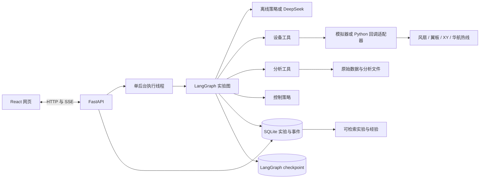
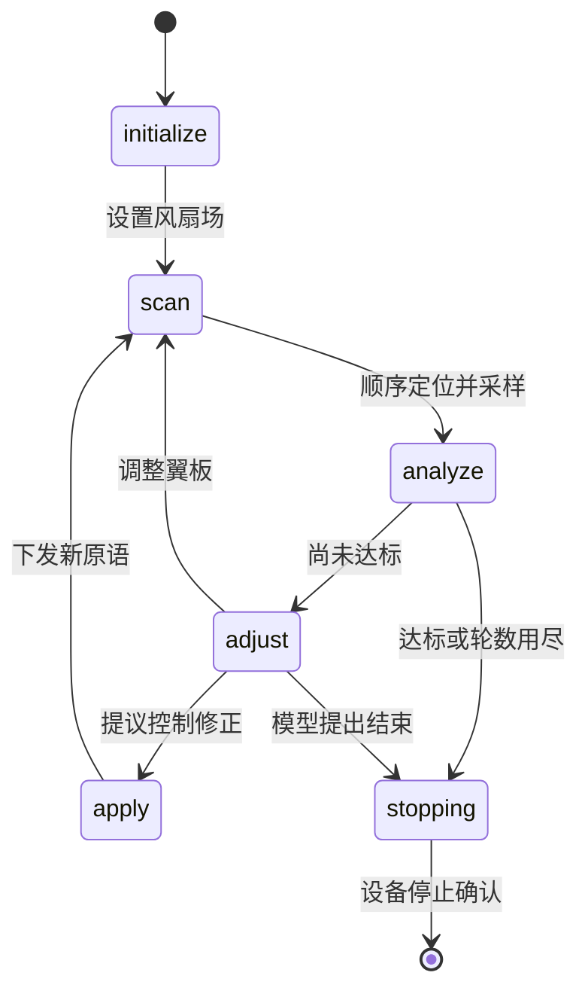

# 02 架构与代码地图

## 模块关系



网页、API、实验执行与设备适配分别有边界。当前在一个进程内运行 API 和后台线程。未来把适配器部署到设备电脑时，仍需要增加远程传输、身份校验和执行端租约。

## 代码阅读顺序

| 文件 | 负责什么 | 什么时候修改 |
|---|---|---|
| `labagent/models.py` | 实验目标、测点、原语、翼板与工具参数 | 增加参数或校验 |
| `labagent/specs.py` | 校验并在模拟器中展开风场原语 | 对接新的原语 |
| `labagent/tools/devices.py` | 设备协议、模拟器和回调适配器 | 接风扇、龙门架和热线 |
| `labagent/tools/analysis.py` | 统计、误差和 SVG 对比图 | 增加分析特征或图表 |
| `labagent/tools/control.py` | 统一策略接口和反馈修正 | 换控制算法 |
| `labagent/agent.py` | 分层工具清单、可用工具、离线与模型决策 | 改提示词或决策上下文 |
| `labagent/runner.py` | 图节点、工具执行、暂停恢复与预算 | 改实验步骤 |
| `labagent/store.py` | 任务、事件、操作事实与长期记录 | 改存储与检索 |
| `labagent/api.py` | 网页接口、后台生命周期、事件和下载 | 增加页面功能接口 |
| `labagent/web/app.js` | React 页面 | 改交互与展示 |
| `labagent/web/style.css` | 响应式样式 | 改外观 |
| `labagent/__main__.py` | 本地启动入口 | 改启动参数 |

根目录原有 `motor_agent.py`、`motor/`、`thinking_module.py` 和 `memory_module.py` 继续提供原来的入口。新平台通过新的事实表保存结构化实验记录，旧文字记忆与旧电机历史仍可独立使用。后续可按来源和标定信息显式迁移历史记录。

## ReAct 如何运行



图只有 `reason` 和 `act` 两类节点循环，实验阶段决定允许使用的工具。模型可以在反馈阶段选择算法修正、自行提出新的风场原语、调整翼板或说明结束原因。扫描、分析和最终验收仍按实验顺序执行。

观测来自工具返回值。最近六次工具调用进入模型上下文，更完整的事件历史在数据库中。网页展示模型明确输出的决策摘要、参数和工具结果。

每轮是否达标由代码检查所有测点的平均风速误差，以及用户配置的可选湍流度误差。模型提前结束只产生预算结束结果。

## 三类记忆

| 层次 | 位置 | 内容 |
|---|---|---|
| 模型上下文 | checkpoint 中的最近工具历史 + 每次组装的提示词 | 当前任务、最近动作、分析结果和相关经验 |
| 持久化实验状态 | `lab.sqlite3` 与 `checkpoints.sqlite3` | 任务介绍、阶段、轮次、待执行节点、操作事实、事件、预算 |
| 长期记忆 | `lab.sqlite3` 的 memories 表 + 关联产物 | 实验事实、控制参数、分析依据、候选经验及适用条件 |

数据库任务表适合网页查询，checkpoint 适合恢复图执行位置。操作日志补足设备完成与 checkpoint 提交之间的时间窗口。

长期记录分两类。

- `experiment` 保存结构化实验事实，状态为 `recorded`。
- `experience` 保存带证据引用的候选经验，可标记 `verified`、`disputed` 或 `expired`。

检索先匹配 `project_id`、`device_id` 和 `calibration_version`，再进行关键词过滤。争议或过期记录退出默认检索。第一版使用 SQLite 关键词方式，中文长句可先拆成简短关键词。

每个新实验检索最多五条最近适用记录给模型参考。离线反馈基线只使用当前实测误差，便于比较。

## 原始数据与统计

```text
lab_data/
  lab.sqlite3                 任务、事件、操作和长期记忆
  checkpoints.sqlite3         LangGraph 恢复状态
  service.lock                服务运行目录的操作系统锁
  artifacts/
    exp-.../
      ...measure.json         原始风速样本、位置、时间、标定
      iteration-001-analysis.json
      iteration-001.svg
```

原始采样保存在文件中，checkpoint 和模型主要接收统计与引用。每次采集和每轮分析分别保存文件。

统计定义如下。

- 平均风速为窗口内样本均值。
- 脉动标准差采用窗口总体标准差，分母为样本数 N。
- 湍流度为标准差除以平均风速，均值接近零时返回空值。
- 风场 RMSE 为各测点风速误差平方的均值再开方，所有测点等权。
- 达标要求每个测点满足误差上限，因此单个大误差无法被平均值抵消。

这些统计以固定采样窗口计算。采样率、窗口长度、滤波和仪器标定仍需要结合实际实验确定。

## 工具为何保持少量

```text
设备层 devices
  set_fan_field       风场原语设置
  set_flap            翼板设置
  scan_field          内部组合 move_probe + measure_hotwire

分析层 analysis
  analyze_field       内部完成统计、误差和图表

控制层 control
  propose_adjustment  内部调用统一策略接口
```

FFT、频谱、滤波、绘图细节可以逐步加入分析模块，策略算法可以逐步加入控制模块。新增内部算法不必增加 Agent 可见工具数量。
