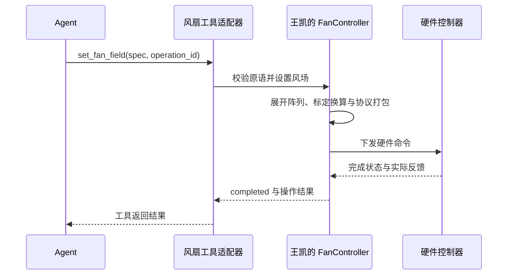
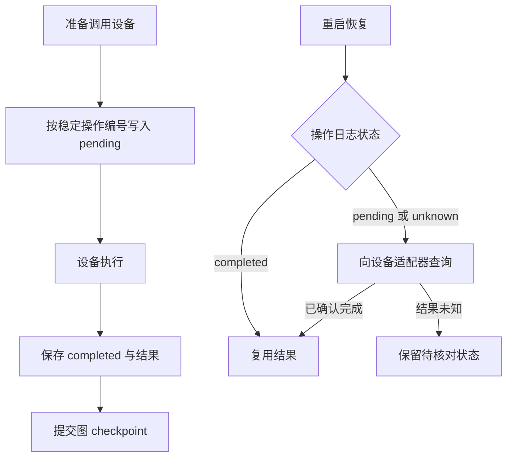

# 03 硬件对接与修改

## 与王凯的职责边界



Agent 输出精简的物理风速原语。原语列表按顺序覆盖，数值单位 m/s。王凯的控制库负责阵列展开与硬件下发。`operation_id` 是外围执行包装的参数，可由适配器传给支持它的网关，或通过本地持久日志与厂商编号建立映射。

当前压缩包提供设计文档与配图，因此平台建立了临时兼容的 Pydantic 契约。王凯提供实际 `fan_specs.py` 后，应将 `models.py` 中的原语模型替换为对共享 schema 的导入，再跑本项目测试，确保只有一份权威定义。

## 原语支持与待对齐项

当前支持 `uniform`、`gradient`、`rect`、`gaussian`、`row`、`column`、`profile`。

```json
{
  "spec": [
    {"type":"gradient","axis":"x","from":8,"to":3}
  ]
}
```

```json
{
  "spec": [
    {"type":"uniform","value":4},
    {"type":"rect","x0":0,"y0":0,"x1":7,"y1":23,"value":7}
  ]
}
```

以下项目需要双方在实机接入前对齐。

- 文档暂定 24 行 × 32 列，真实安装方向和零点需确认。平台行列数可配置。
- `rect` 包含两个端点，原文示例出现的 `y1=32` 应按实际行数修正。
- `profile.custom.values` 长度与轴对应，y 方向为行数，x 方向为列数。
- 当前模拟展开中，高斯图层在全场计算 `baseline + amplitude × exp(...)` 并覆盖下层，需要与控制库保持一致。
- `profile.power` 当前要求显式 `heights_m` 数组。若王凯从设备 config 取得高度，适配层应将这个扩展字段转换为对应配置引用。
- `raw` 档位矩阵可在后续单独加入口，届时需明确档位与 m/s 混合图层的规则。
- 原语参数风速与探针实测风速之间有气动耦合，测点对应风扇单元的反馈基线需要标定与实验验证。

## 华航热线与龙门架接口

`CallbackDevices` 接收你已有的 Python 函数。回调返回前应完成实际动作，或在回调中查询完成状态。各回调须设置适合设备的超时。

| 回调 | 输入 | 返回要求 |
|---|---|---|
| `set_fan_field` | `spec`、`operation_id` | 实际完成后返回 `completed=true` |
| `set_flap` | 角度、振幅、频率、`operation_id` | 实际完成后返回 `completed=true`，可选 |
| `move_probe` | `x_mm`、`y_mm`、`operation_id` | 确认到位后返回 `completed=true` |
| `hotwire` | 测点、位置、数量、采样率、`operation_id` | 原始样本及采集元数据 |
| `lookup_operation` | `operation_id` | 返回同一操作的可信原始结果，结果未知时返回 `None` |
| `stop` | 无 | 全部相关设备停止确认后返回 `completed=true` |

热线回调返回示例。

```json
{
  "samples_mps": [3.9, 4.0, 4.1, 4.0],
  "sample_rate_hz": 100,
  "point_id": "p1",
  "x_mm": 0,
  "y_mm": 100,
  "timestamp": "2026-11-05T08:00:00+00:00",
  "quality": "good",
  "calibration_version": "hotwire-calibration-2026-11"
}
```

样本数、采样率、位置和标定版本需要与本次请求一致。采样中断或质量不合格时返回错误，保留原程序诊断。现有采集程序若使用电压或其他单位，需要先通过其标定流程转换为 m/s。

## 创建实机服务

以下示例中的 `my_lab_drivers` 代表你们已有程序的包装模块，需要按真实库名称替换。

```python
from pathlib import Path
import uvicorn
from labagent.api import create_app
from labagent.tools.devices import CallbackDevices
from my_lab_drivers import fan, gantry, huahang, gateway


def device_factory(config):
    return CallbackDevices(
        config,
        set_fan_field=fan.set_field_and_wait,
        move_probe=gantry.move_and_wait,
        hotwire=huahang.measure,
        stop=gateway.stop_all_and_wait,
        lookup_operation=gateway.lookup_operation,
    )


app = create_app(Path('lab_data_hardware'), device_factory=device_factory)

if __name__ == '__main__':
    uvicorn.run(app, host='127.0.0.1', port=8765, workers=1)
```

创建真实实验前，将网页高级配置的 `device_id` 和 `calibration_version` 改为实际值。接口层会要求真实设备声明明确的设备与标定标识。运动范围、限位、回零、功率与通信保护由真实适配器和控制系统实现。

网页的独立工具调试页面始终使用模拟器。实机调试通过有任务编号和操作日志的实验流程进行。

## 恢复时如何避免重复动作



本地数据库事务保存每条事实，外部硬件与 checkpoint 之间通过操作编号和查询恢复对账。真实适配器需要把编号映射与结果持久化，跨设备原子提交还需要结合实际网关设计。

`stop()` 应设计为幂等动作。确认失败后，待停止的目标状态会记录在任务表，继续操作时先完成停止确认。

## 如何增加数据分析

第一步在 `tools/analysis.py` 中新增内部函数，例如频谱特征。

第二步在 `runner.py` 的 `analyze()` 中调用，并将结果写入每轮分析 JSON。较大数组放单独文件，摘要只保存文件引用。

第三步在网页结果区域增加对应展示。实验完成时，分析产物引用会随实验记录进入长期记忆。

已有 `analyze_field` 工具可以覆盖这条路径，FFT 等细节可以继续留在模块内部。

## 如何替换控制策略

`ControlStrategy` 约定一个统一方法。

```python
def propose(config, current, measurements, *, gain=0.8) -> list[dict]:
    ...
```

返回值是新的风场原语列表。当前 `FeedbackStrategy` 对每个映射单元进行限幅比例修正，`gain` 是反馈增益。

后续增加贝叶斯优化或其他控制器时，在 `tools/control.py` 或该目录下的策略子模块实现这个接口，再替换 `ExperimentRunner.strategy`。如算法需要额外状态，应将可序列化状态显式加入 checkpoint，并保存策略版本与分析来源。

算法输出继续经过原语范围与单轮变化校验。长期经验可以记录策略名称、版本及适用条件。PPO、SAC 等策略需要另行定义训练环境、动作空间和验证流程。

## 常见修改入口

| 想修改的内容 | 修改入口 |
|---|---|
| 网页默认测点与默认目标 | `api.py` 的 `/api/example` |
| 模型如何看待任务与反馈 | `agent.py` 的 `ModelPolicy` |
| 开放哪些工具、允许什么顺序 | `agent.py` 的 `allowed_tools` |
| 本轮达标条件 | `tools/analysis.py` 的 `evaluate_field` |
| 模拟风扇响应 | `tools/devices.py` 的 `SimulatedDevices` |
| 自动修正算法 | `tools/control.py` 的 `FeedbackStrategy` |
| 长期记忆字段与检索 | `store.py` 的 `remember`、`memories` |
| 文件和经验如何关联 | `runner.py` 的 `analyze`、`remember` |
