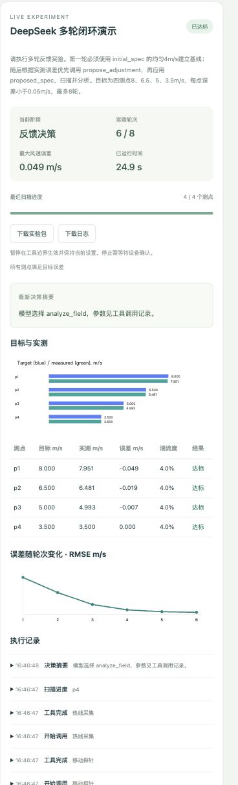

# 05 DeepSeek 前端实测演示

本次演示于 2026 年 11 月 5 日执行，使用已配置的 deepseek-chat 真实接口及模拟风扇、XY 龙门架和热线反馈。

## 如何复现

1. 打开 http://127.0.0.1:8765，选择 DeepSeek ReAct。
2. 展开高级参数，粘贴 [演示配置](示例/DeepSeek多轮演示配置.json)，点击应用 JSON。
3. 启动实验，观察逐轮扫描、分析和控制修正。
4. 展开执行记录里的“开始调用设置风扇风场”，查看原语、参数和操作编号。
5. 点击下载实验包或下载日志，保留完整记录。

实验介绍中写入了初始均匀 4 m/s、四测点目标 8、6.5、5、3.5 m/s，以及优先用反馈策略修正的说明。实验目标同时由结构化参数明确定义。

## 实际结果

任务编号为 `exp-0c9cc497c21c4bbb`。耗时约 24.9 秒，模型选择工具 23 次，完成 6 轮实验，各测点最终误差满足 0.05 m/s，最后确认模拟设备停止。

| 轮次 | 最大绝对误差 m/s | RMSE m/s |
|---|---|---|
| 1 | 4.480000 | 2.790233 |
| 2 | 2.839596 | 1.590336 |
| 3 | 1.199325 | 0.648271 |
| 4 | 0.412453 | 0.222925 |
| 5 | 0.141845 | 0.076658 |
| 6 | 0.048781 | 0.026361 |

实际决策包括 6 次设置风场、6 次扫描、6 次分析和 5 次控制修正。模型输出工具调用，反馈算法计算有界修正参数，数值代码检查是否达标。设备采样由模拟器生成。

[结构化演示结果](示例/DeepSeek多轮演示结果.json) 保存了每轮统计和原始数据引用。工作台历史记录中可查看本次任务。

## 前端截图

[完整前端调试截图](图片/DeepSeek前端调试全页.jpg) 包含已展开的风扇原语 JSON。

模型本次主要返回工具调用，决策摘要区域使用了工具名称摘要。具体参数、结果和误差通过可展开日志查看。任意自然语言自动生成完整测点方案仍可在后续增加。
