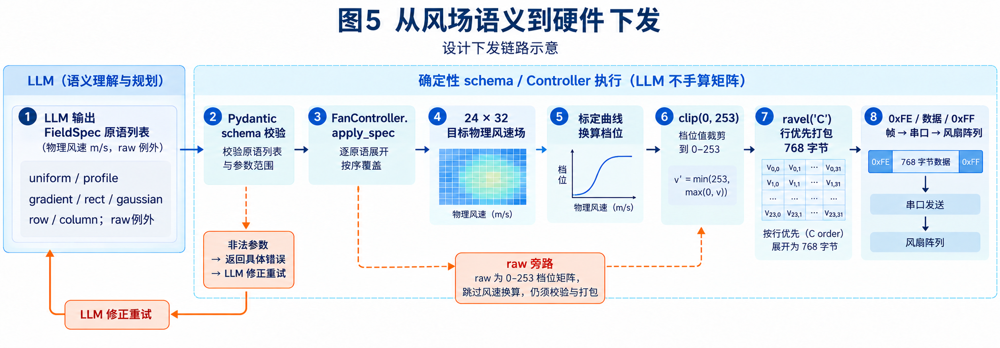
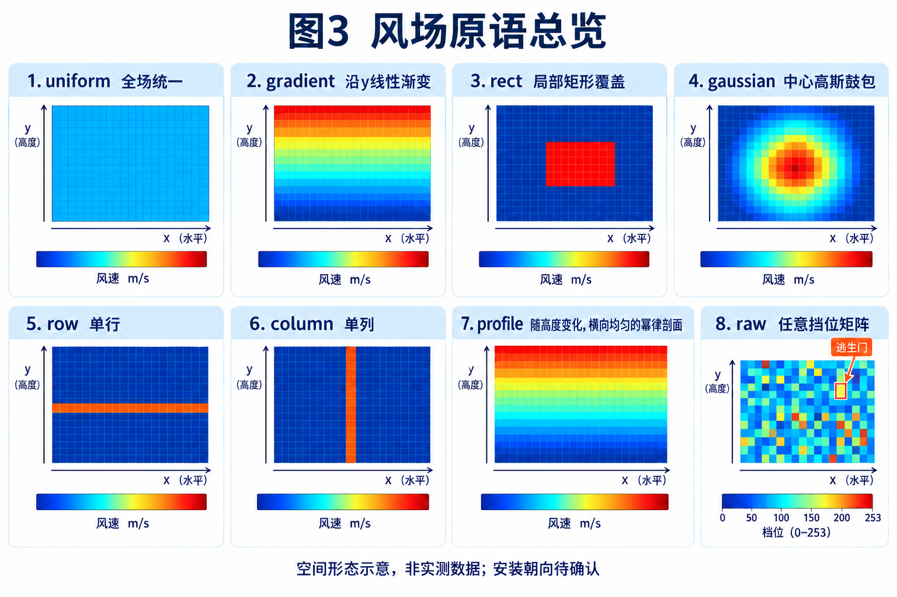
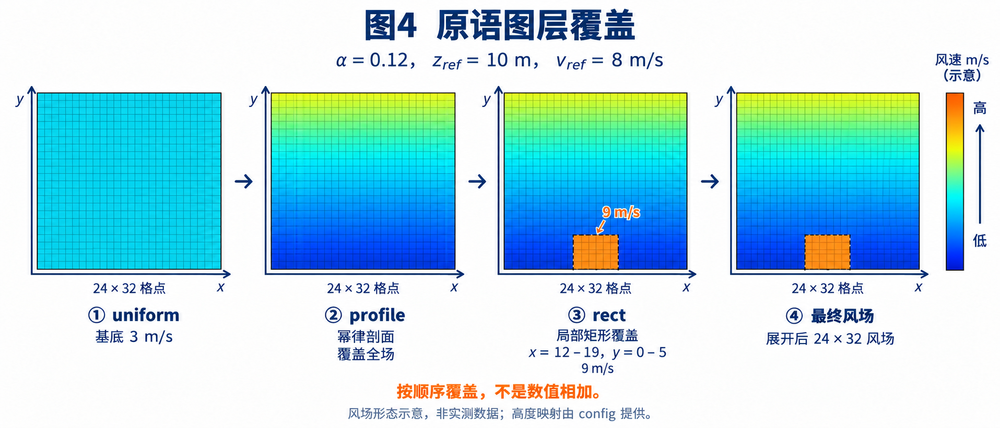

# 07 原语清单与设计

- 日期：2026-10-30（归档入开发说明：2026-11-16）
- 项目：风洞实验室自主实验智能体
- 关联文档：[风场控制-LLM输出表达方式对比分析.md](../../报告/风场控制-LLM输出表达方式对比分析.md)（方案选型）、[01-agent结构与分层.md](../../报告/01-agent结构与分层.md)（归属层级）、[03-tool清单与用法.md](../../报告/03-tool清单与用法.md)（spec 的使用方）

---

## 一、原语设计的作用与归属（先读这节）

### 1.1 作用：为什么需要原语

- 风扇阵列是 **768 维连续场**（24×32，每点一个风速），LLM 无法稳定输出 768 个精确数字（数量幻觉、越界、数位错误、无空间语义）——详见对比分析报告第 2 节。
- 原语把「描述场」从「列数字」变成「**说形状**」：LLM 用 O(几十) 个参数表达一个场，代码把参数确定性地展开成 768——**LLM 说意图，代码算数字**。
- **原语即关键帧**：一个原语列表既是一个静态场，也是时序序列的一帧；未来「预设计多帧画面、批量下发」直接复用同一套表达。
- 原语是**语义形状**（均匀/梯度/高斯/剖面），与 LLM 天然的表达方式对齐，生成成功率远高于裸矩阵。

### 1.2 归属：原语属于谁

- 原语**不是 tool、不是设备、不是实验**。它是「风场描述语言」，即风扇控制 tool `set_fan_field` 的**参数 schema**。
- schema（pydantic 类）在**库层只定义一次**（如 `fan_specs.py`）；`set_fan_field` 与 `calibrate_fan_field`（target 参数）引用**同一份**：
  - 校验只有一份，展开只有一份；
  - LLM 看到的两个 tool 参数结构完全一致，永不漂移；
  - 新增原语一处修改、两处生效。
- 展开成 24×32 是 `FanController` 的活，**LLM 永远不碰 768 个数字**。

### 1.3 通用语义（所有原语共同遵守）

1. **图层叠加**：spec = 原语列表，按顺序叠加，**后者覆盖前者**。
2. **值域 = 物理风速（m/s）**：原语数值一律是物理风速。档位（0~253）换算封装在 FanController 内部（config 标定曲线，首版近似线性）。闭环校准的比值修正对曲线误差不敏感（近似曲线在前后两次换算中抵消，只影响收敛速度、不影响收敛正确性）。
3. **下发链路**：展开叠加 → 换算档位 → clip(0,253) → `ravel('C')` 行优先打包 768 字节 → `0xFE`/`0xFF` 帧 → 串口。
4. **索引约定**：`y` = 行（0~23），`x` = 列（0~31）。假设 24 行对应竖直高度方向，则 y = 高度、x = 水平跨度（安装朝向待确认）。
5. **唯一例外**：`raw` 原语值域是档位 0~253（逃生门语义，见 2.7）。

---

### 1.4 从语义到硬件的下发链路



*图5｜语义描述到硬件下发；raw 使用档位语义，跳过风速换算。*

---

## 二、原语逐个详解



*图3｜风场原语空间形态概览；颜色仅示意相对大小，网格不作为精确离散计算结果。*

### 2.1 `uniform` — 全场统一

| 项 | 内容 |
| --- | --- |
| 参数 | `value`（m/s） |
| 展开 | 24×32 全部 = value |
| 适用场景 | 起风/关风；均匀来流实验；组合场的基底图层 |
| 示例 | `{"type":"uniform","value":8.0}` |
| 注意 | 单个 uniform 即旧 mock 工具 `set_fan_matrix` 的语义（全场统一风速） |

### 2.2 `gradient` — 线性渐变

| 项 | 内容 |
| --- | --- |
| 参数 | `axis`（`x`/`y`）、`from`、`to`（m/s） |
| 展开 | 沿 axis 从 `from` 线性插值到 `to`（x：32 列；y：24 行），垂直方向均匀 |
| 适用场景 | 斜向风场、渐变风、过渡区；多段可拼复杂趋势 |
| 示例 | `{"type":"gradient","axis":"y","from":0,"to":10.0}` |
| 注意 | **幂律剖面不是线性的，不要用它硬凑地貌风剖面（用 profile）** |

### 2.3 `rect` — 矩形区域

| 项 | 内容 |
| --- | --- |
| 参数 | `x0,y0,x1,y1`（含端点）、`value`（m/s） |
| 展开 | 矩形内 = value，其余露出下层图层 |
| 适用场景 | 局部增强/减弱；分区实验；校准后的小范围修补贴片 |
| 示例 | `{"type":"rect","x0":0,"y0":0,"x1":8,"y1":32,"value":5.0}` |
| 注意 | 边缘陡变；要平滑过渡用 gaussian |

### 2.4 `gaussian` — 高斯鼓包

| 项 | 内容 |
| --- | --- |
| 参数 | `cx,cy`（中心，格点坐标）、`sigma`（格距）、`amplitude`（m/s），可选 `baseline` |
| 展开 | `amplitude·exp(−((x−cx)²+(y−cy)²)/(2σ²))`，可选叠加 baseline |
| 适用场景 | 局部强风模拟、涡/喷流中心、修补局部测量偏差 |
| 示例 | `{"type":"gaussian","cx":16,"cy":12,"sigma":4,"amplitude":6.0}` |
| 注意 | `sigma` 单位是风扇间距（格）；σ 过小（<1）时退化为单点强风 |

### 2.5 `row` / `column` — 整行 / 整列

| 项 | 内容 |
| --- | --- |
| 参数 | `y` / `x`（索引）、`value`（m/s） |
| 展开 | 一行 / 一列全部 = value |
| 适用场景 | 校准后逐行精细调平；单行/单列修正（如某行被遮挡的补偿） |
| 示例 | `{"type":"row","y":0,"value":3.0}` |
| 注意 | 24 个 row 也能拼出任意剖面，但啰嗦；整体剖面用 profile |

### 2.6 `profile` — 一维剖面（风工程核心原语）

| 项 | 内容 |
| --- | --- |
| 参数 | `axis`（`x`/`y`）；`law="power"` 时：`alpha`（指数）、`z_ref`（参考高度 m）、`v_ref`（参考高度处风速 m/s）；`law="custom"` 时：`values`（24 个 m/s） |
| 展开 | 沿 axis 每行（或列）一个值，行内（列内）均匀。<br>`power`：`u(z) = v_ref·(z/z_ref)^alpha`，其中 z 由「行号→物理高度」映射（config 提供）算出；<br>`custom`：`values` 直接就是 24 个值 |
| 适用场景 | **场景一**：复现某类地貌风剖面（A 类 α≈0.12、B 类 0.16、C 类 0.22、D 类 0.30，以所用规范为准）；**场景二**：给定目标剖面复现。风工程实验的核心原语 |
| 示例 | `{"type":"profile","axis":"y","law":"power","alpha":0.12,"z_ref":10.0,"v_ref":8.0}`<br>`{"type":"profile","axis":"y","law":"custom","values":[3.2, 3.5, …共 24 个…]}` |
| 注意 | ① 依赖「行号→高度」映射（config）；② custom 的 24 个数通常来自**用户给定数据透传**（LLM 抄写而非心算），可靠性远高于裸矩阵；③ 未来可加 `law="log"` 对数律 |

### 2.7 `raw` — 逃生门

| 项 | 内容 |
| --- | --- |
| 参数 | `matrix`（24×32，**档位 0~253**） |
| 展开 | 直接就是命令矩阵（唯一保留档位语义的原语） |
| 适用场景 | 仅当原语组合无法表达的逐点任意场（如特定湍流样本的静态近似） |
| 示例 | `{"type":"raw","matrix":[[…24×32 档位…]]}` |
| 注意 | 让 LLM 吐 768 个数不稳定，**明确标注不推荐，仅极端情况使用**；用后建议立即回退到原语表达 |

---

## 三、原语的使用示意

### 3.1 使用总述

- 原语是 `set_fan_field` 与 `calibrate_fan_field` 共享的参数 schema（库层 `fan_specs.py` 只定义一份）：`set_fan_field(spec)` 把 spec 直接展开成风场下发，`calibrate_fan_field(target_spec)` 用同一份 spec 表达目标风场。两者都按「图层叠加、后者覆盖前者」确定性地展开成 24×32，再换算档位下发。
- LLM 只写 spec（几十个参数），**不写也不看 768 个数字**。下面每个示意统一以 `set_fan_field` 举例（直接设置入口）；同一份 spec 原样填进 `calibrate_fan_field` 的 `target_spec`，就是校准要逼近的目标风场。
- 图中竖剖面只画 y（高度）方向一列，横条长度代表风速大小；俯视图里 `·` 是下层露出的空位、`█` 是该原语覆盖的格点。所有图仅为概念示意，不代表精确离散结果。

### 3.2 逐个示意

**① `uniform` —— 全场统一**

- 意图：「起 8 m/s 的均匀来流。」
- 调用：`set_fan_field([{"type":"uniform","value":8.0}])`
- 得到的场：

```
y=23 │████████████████████  8.0 m/s
y=12 │████████████████████  8.0 m/s
y= 0 │████████████████████  8.0 m/s
     └──────────────────────→ 风速        （768 点全同）
```

**② `gradient`（axis=y）—— 线性渐变**

- 意图：「从底部 0 线性升到顶部 10 m/s 的渐变风。」
- 调用：`set_fan_field([{"type":"gradient","axis":"y","from":0,"to":10.0}])`
- 得到的场（每行内 32 列风速相同）：

```
y=23 │████████████████████ 10.0 m/s
y=12 │██████████            5.0 m/s
y= 0 │                      0.0 m/s
     └──────────────────────→ 风速
```

**③ `rect` —— 矩形区域（叠加在下层上）**

- 意图：「在既有场的底部中段加一块 9 m/s 的矩形增强区。」
- 调用：`set_fan_field([…下层…, {"type":"rect","x0":12,"y0":0,"x1":19,"y1":5,"value":9.0}])`
- 得到的场（俯视，只画底部 6 行）：

```
        x=0 ··· 12 ──── 19 ··· 31
y= 5 │ ········████████········
y= 0 │ ········████████········
      └ 矩形内（y0~5、x12~19）= 9.0 m/s，其余格点露出下层
```

**④ `gaussian` —— 高斯鼓包**

- 意图：「在阵列中心 (16,12) 造一个 σ=4 格的 6 m/s 鼓包（局部强风 / 涡心）。」
- 调用：`set_fan_field([{"type":"gaussian","cx":16,"cy":12,"sigma":4,"amplitude":6.0}])`
- 得到的场（俯视，`·`≈0 m/s）：

```
        x=0 ····· 16 ····· 31
y=23 │ ············· ·············
y=12 │ ······████████████········
y= 0 │ ············· ·············
      └ 中心 (16,12) 最高 ≈6 m/s，向四周按高斯衰减
```

**⑤ `row` / `column` —— 整行 / 整列**

- 意图：「把最底下一行（y=0）单独调到 3 m/s（如补偿该行遮挡）。」
- 调用：`set_fan_field([{"type":"row","y":0,"value":3.0}])`
- 得到的场（俯视，只画底部两行）：

```
y= 1 │ ································   （其余行露出下层）
y= 0 │████████████████████████████████  3.0 m/s
     └ x=0 ────────────────────────→ x=31
```

**⑥ `profile` —— 一维剖面（风工程核心）**

- 意图：「复现 A 类地貌（α=0.12）幂律风剖面：参考高度 10 m 处 8 m/s。」
- 调用：`set_fan_field([{"type":"profile","axis":"y","law":"power","alpha":0.12,"z_ref":10.0,"v_ref":8.0}])`
- 得到的场（幂律曲线，底部慢、顶部快）：

```
y=23 │████████████████████  顶部快
y=12 │███████████████
y= 0 │████████              底部慢
     └──────────────────────→ 风速
     u(z) = 8·(z/10)^0.12，z 由「行号→物理高度」映射（config）给出
```

**⑦ `raw` —— 逃生门**

- 意图：「表达一个原语拼不出来的逐点任意场（仅极端情况）。」
- 调用：`set_fan_field([{"type":"raw","matrix":[[…24×32 个档位 0~253…]]}])`
- 得到的场：命令矩阵即矩阵本身，跳过风速换算（唯一档位语义）。**不推荐**，用后立即回退原语表达。

> 多个原语叠加的完整用法见下一节（第四节 组合示例）。

---

## 四、组合示例



*图4｜原语按序覆盖示意；幂律图层覆盖全场，矩形图层仅覆盖局部。*

**A 类地貌剖面 + 底部局部增强（两层图层）：**

```json
[
  {"type": "uniform",  "value": 3.0},
  {"type": "profile",  "axis": "y", "law": "power", "alpha": 0.12, "z_ref": 10.0, "v_ref": 8.0},
  {"type": "rect",     "x0": 12, "y0": 0, "x1": 19, "y1": 5, "value": 9.0}
]
```

语义：全场 3 m/s 基底 → 叠加 A 类幂律剖面 → 底部中段一块 9 m/s 矩形增强区。展开顺序即图层顺序，后写的覆盖先写的。

---

## 五、候选扩展（按需补充）

| 原语 | 用途 | 状态 |
| --- | --- | --- |
| `sine` | 正弦条纹 / 周期风场 | 待定 |
| `ring` | 环形区域 | 待定 |
| `radial_gradient` | 径向渐变 | 待定 |
| `profile` 加 `law="log"` | 对数律风剖面 | 待定 |
