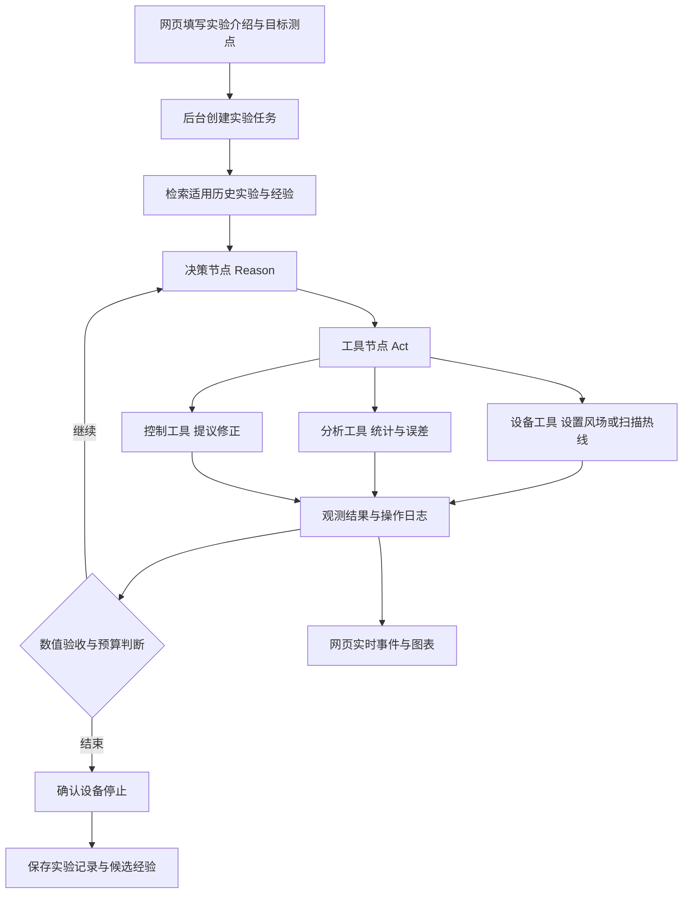
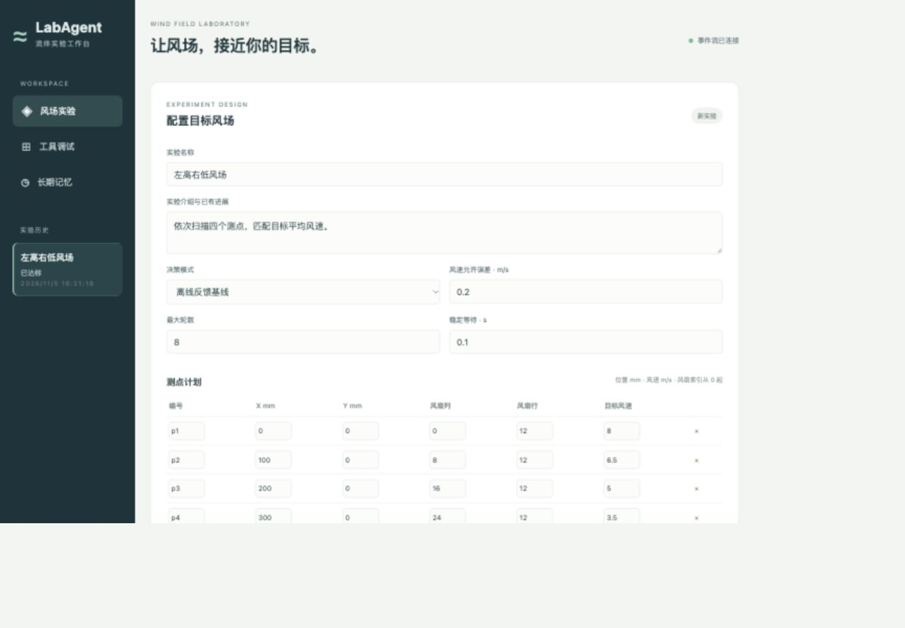
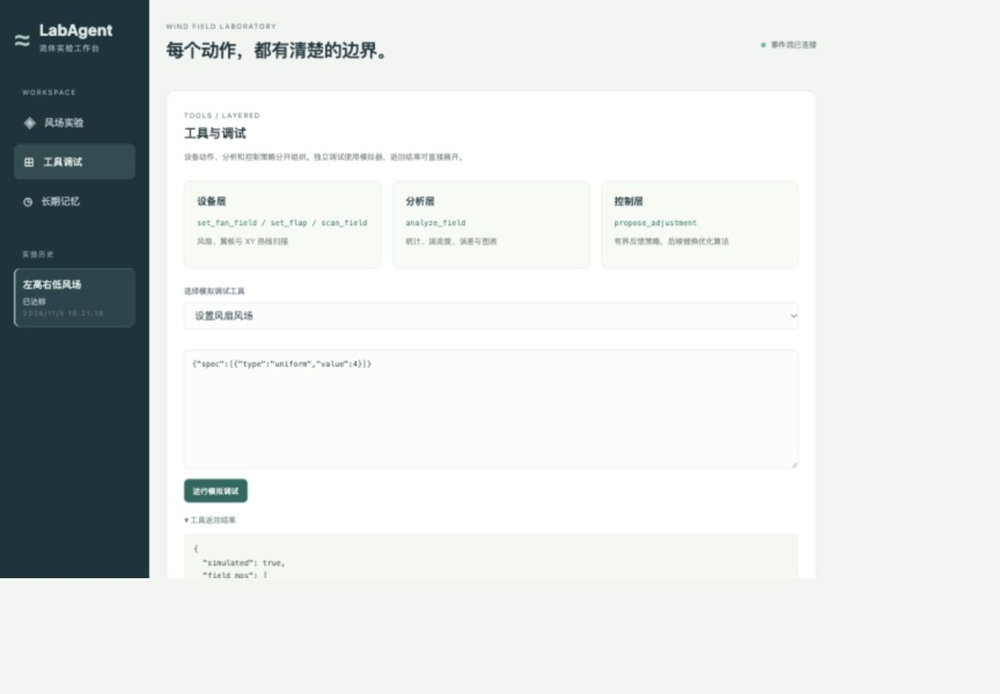
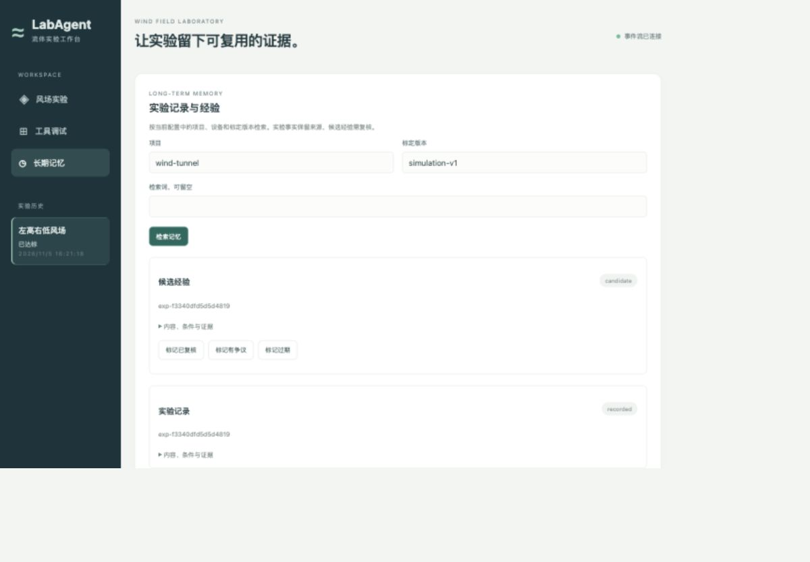

# 风洞实验 Agent 开发说明

更新日期为 2026 年 11 月 5 日。本文件夹介绍本次交付的单机平台，建议按编号阅读。

## 从哪里开始

| 文档 | 帮你解决的问题 |
|---|---|
| [01 启动与操作](01-启动与操作.md) | 如何打开网页、运行实验、查看日志和导出数据 |
| [02 架构与代码地图](02-架构与代码地图.md) | ReAct、工具、后台任务和三类记忆如何配合 |
| [03 硬件对接与修改](03-硬件对接与修改.md) | 王凯的风扇工具、华航热线、龙门架怎么接，算法怎么换 |
| [04 验证与后续开发](04-验证与后续开发.md) | 本次验证结果、当前适用范围和后续工作 |
| [05 DeepSeek 前端演示](05-DeepSeek前端演示.md) | 真实模型调用、六轮反馈结果与复现配置 |
| [示例实验 JSON](示例/左右不同风速.json) | 可复制到网页高级配置的完整实验参数 |

## 本次完成的能力

- 新增 `labagent/`，提供 React 网页、FastAPI 接口和独立于网页请求的单后台执行线程。
- LangGraph 运行受约束的 ReAct 循环，支持离线反馈基线与 DeepSeek 模型工具调用。
- 支持多测点目标平均风速、可选湍流度目标、风扇原语、翼板参数和 XY 热线扫描。
- 设备、分析、控制策略三层工具独立组织。扫描工具内部组合探针移动与热线采样。
- 分析平均风速、脉动标准差、湍流度和各点误差，输出对比 SVG、误差趋势和 CSV 数据。
- SQLite 保存实验介绍、目标、进度、操作、事件和长期记录，LangGraph SQLite checkpoint 保存图的执行位置。
- 原始采样文件与摘要分开存储，历史记录按项目、设备和标定版本检索，候选经验可复核、标记争议和过期。
- 网页提供启动、工具边界暂停、继续、停止、可展开决策摘要、工具输入输出、错误和下载。
- 提供王凯与华航已有程序的回调适配接口，默认启用模拟设备。

## 先看整体流程



## 界面截图

下图来自浏览器实际运行的模拟实验。四个目标测点在第 3 轮达标，最大风速误差约为 0.129 m/s。



工具调试按设备、分析和控制三层展示。



长期实验事实与候选经验分开显示。



## 本机立即启动

在项目根目录执行以下命令，然后打开网页。

```bash
.lab-venv/bin/python -m labagent
```

默认地址为 [本地工作台](http://127.0.0.1:8765)。默认端口被占用时可加 `--port 8766`。

本次实现采用 SQLite、单执行线程和本地 React 静态资源，启动网页只需要 Python 环境。第一版控制算法采用限幅比例反馈，湍流度联合优化和时变场同步实验保留后续接口。DeepSeek 真实接口已完成六轮模拟闭环验证。设备回调已定义，实机对接仍需使用你们已有的控制与采集程序完成联调。
